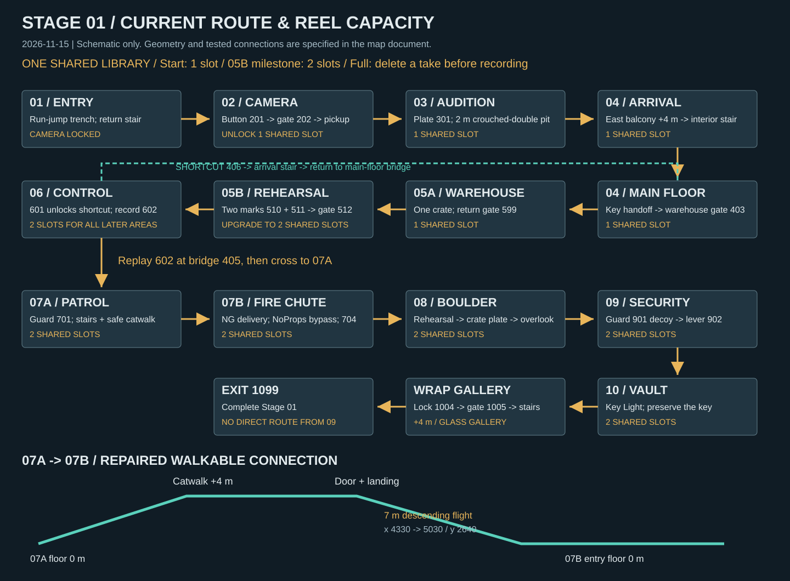

# Stage 01 · L_Stage01_Soundstage — Selected Design and Implementation Notes

> **Selected translated excerpts; full historical specification is not included.**
> Source: `Studio/Design/Maps/L_Stage01_Soundstage.md`, v1, initially dated 2026-11-14, with implementation updates through 2026-11-16. These excerpts retain the source's design intentions, later implementation corrections, and stated verification limits. Earlier proposed dimensions are not a substitute for the latest construction coordinates.
> UE level asset: `/Game/MegaJam/Maps/L_Stage01_Soundstage`.

## Design Intent and Spatial Structure

The first full level is a tutorial set in **one three-level indoor soundstage with 10 interconnected subareas**. It replaces isolated rooms and a linear chain of one-room-one-puzzle spaces with a central double-height drawbridge hall (`Area 04`), vertically interwoven routes, early views through windows, and a later return through a **Dark Souls-style shortcut**.

The key whole-map puzzle uses the shared editing desk and cross-area wiring: record a double holding power at the `2F` console, take the shortcut back to `1F`, then call Action to lower the central bridge. The player experiences the map as one connected place, with a readable loop rather than a confusing maze.

The source's opening target is about **15.5–18.5 minutes** for a first visit. Its later detailed timing table totals **16.5–20.5 minutes**, across **10 interconnected subareas / 9 core interaction nodes**. Both estimates are retained here as design estimates, not measured completion times.

### Tutorial Boundaries

- **No slow-motion cameras** appear in this level; they are reserved for later levels.
- Before the handheld camera is collected, hide editing-desk, timeline-strip, and reel-slot UI and disable `R / Q / TAB / G`. The opening teaches movement, sprinting/jumping, and ordinary button interaction.
- Introduce the **Key Light** formally only in the finale (`Area 10`). An observation window in `Area 02` foreshadows its warm golden beam. The final encounter explicitly previews more special film equipment in later stages that can change the rules.

### Progression and Capacity

| Areas | Selected Role |
|---|---|
| `01–02` | Camera-free entrance tutorial, running-jump trench, ordinary access button, backstage corridor, camera pickup |
| `03` | One person holds a plate while another passes; then climb a crouched double to escape a `2.0 m` stairless pit |
| `04–05` | Central landmark, key handoff across a trench, one-crate swap, then two-track plate coordination |
| `06` | Upper drawbridge console, permanent shortcut, and cross-area recorded power for the bridge |
| `07–08` | Guard observation/avoidance, fatal-delivery recording through a fire wall, then a boulder cooldown puzzle |
| `09–10` | Lure a guard away, solve the Key Light vault, and finish along a glass overlook corridor |

**11/15 capacity correction:** the slot counts represent **whole-map progression capacity**, not separate room quotas. `Area 03→05A` has **1 global slot**; first entering `05B` upgrades to **2 global slots**. `06→10` and revisited earlier areas retain 2. Media and clips persist across rooms. At total capacity, manually delete a Take before recording again. Room subdivisions govern spatial ownership, prop boundaries, and guard movement ranges. Recording at `602` and returning to `04` to play back for bridge `405` remains intentional.

## Current Diagram and How to Read It

The current diagram, `L_Stage01_Topology.svg`, is generated by `Tools/draw_stage01_topology.py`. It shows global recording capacity, the drawbridge loop, and the `7A→7B` route back to ground level. **It is a topology diagram, not a dimensioned construction drawing.** Two older concept images and old paper-review records were moved to `Design/archive/Stage01_concept_drawings/`.

The main vertical organization is an upper mezzanine/control/overlook level, the main soundstage datum, and lower cable/stunt trenches. Use the construction updates and actual UE traversal for current geometry; do not infer dimensions from concept-image pixels.

## Built Layout and Later Corrections

### Initial Build Differences

The 11/14 implementation entry records that Codex B built the level in R13, made it the default map, and passed **17 module PIE tests**. Differences from the design specification included:

- The warehouse uses **14 m straight steel stairs + a switchback landing**, replacing the spiral ramp.
- `5B` has **5 m clear height**, without an overhead lighting grid.
- The boulder danger section is a level, enclosed track.
- `804` is **100 cm before the tripwire**; the crate remains **16 m** from the tripwire.
- `701` patrols at `x=3550`, `y=2050→1350`.
- The implemented subtitles numbered **10**.

The same day's enclosure revision sealed **8 locations** where players could fall out: the east of 03, east between 05 ramps, 07B's eastern fire-trench mezzanine and north platform edge, west end of 08's overlook walkway, 10's foyer north/east/corner, and beyond the exit door. Roof coverage changed to room roofs only, with the northeastern yard and southern atrium courtyard outdoors. The `Area 02` vault-preview sightline remained through a foyer north-wall window. Puzzles, mechanisms, and checkpoints were unchanged in that revision.

### 11/15 Construction Review

The 7A safe catwalk originally stopped at a doorway **4 m high**, without a complete ground return. The repair added platform `x=4070..4330,y=2450..2680,z=400` and descending steel stairs `x=4330→5030,y=2640,z=400→0`, joining the north side of the 7B entrance without crossing the fire trench or prohibited-prop corridor.

Guard `701`'s old script used world directions in a local path; combined with `yaw=-90`, this sent it toward cover. The corrected local path is `(0,0,0)→(700,0,0)`. Lock `704`, previously floating beside an exit-stair rail, was mounted on a control post at `(3715,4200,-190)`, grounded at `z=-300`; its wiring stayed unchanged.

Continuous playtesting exposed inadequate capsule turning clearance. Corrections included 7A's stair foot `(4200,900,0)`, 7B's bypass stair foot `(4800,4180,-300)`, the boulder-view ascent centered at `x=2240` with **220 cm** width, and the vault escape stair foot `(230,3900,0)`. The fire-trench entrance wall was shortened to `y=2500..2700`; the warehouse upper platform starts at `y=2400`, removing a **40 cm** overlap.

The final straight staircase trapped the player against its top rail. It became a two-flight switchback: `(-2150,3380,0)→(-2500,3380,200)`, a **160×400 cm** landing, then `(-2500,3180,200)→(-1900,3180,400)`. Width is **180 cm**, risers at most **16 cm**, with grounded supports and lighting. North glass remains only at `x=-800..1600`, the section genuinely open toward the atrium.

Drawbridge `405` is **10 cm** thick, with deployed top surface `z=0`; underside ribs and hinge move with it. Boulder `803` cooldown became **6.5 s**: wait until the first boulder leaves before carrying the crate across.

### Later Playtest, Assets, and Animation Changes

After the producer's late-night 11/15 playtest:

- Bridge-pit depth changed **2.5 m → 6 m**. Three tracks could stack three doubles about **4.4 m** high, allowing escape to the east bank at the old depth. Return stairs still reach only the west bank and became a **10 m** straight flight.
- 07B's escape room had connected to the safe area beyond the fire, permitting a bypass. It was sealed to return only to the entrance platform; `NoProps 707` was removed, glass sealed above the fire opening, flames became a full wall, and **3 subtitles** were added. Script: `Tools/ue_scripts/s01_route_fixes.py`.

Fab replacement moved audition door `302` to `x=900,y=-1650`, with **300 cm** clear width and no partition intrusion. **14 doors** use steel hinged, sliding, lifting, or double-automatic designs. Opening/closing takes **0.32 s**, with collision following door panels. Switches/buttons depress and rebound in **0.36 s** without clearing latched power; plates depress **2 cm**. Door `202` opens toward the foyer and `599` into the warehouse, avoiding main turns. The source records another full playthrough of this version.

**11/16 ledge revision:** the 07B bypass and vault escape stairs became **1.9 m ledges**, requiring a crouched double to climb and preventing keys from being carried up. `07A→07B` retains only the upper catwalk route. The vault key-pickup window no longer displays glass.

## Verification Evidence and Limits

The **11/15 full-level test** started in a fresh PIE session and completed every solution from entrance to EXIT, with `room_won=true`. It used normal movement, interaction, and recording input; timeline placement/deletion used the same public commands as the UI. There was **no Warp, teleporting, or direct mechanism-state editing**. It also tested rejection of a third recording across rooms when capacity was full.

- Log: `Saved/Stage01FullRun.json`
- Driver: `Tools/ue_scripts/stage01_playthrough.py`
- Leak scan: **48,836 cells / 0 leaks**

Separate performance screenshots used fixed viewpoints and **must not be treated as playthrough evidence**.

The source's verification-boundary section also records a passing **Editor Development build**, PIE checks for shared slots, Take deletion, checkpoint capacity, hint lifetime, both guards detecting/chasing, and **8 stair/connection sections**, with **0 level leaks**. It explicitly distinguishes module checks from end-to-end completion and states **packaging was not tested**. The later 11/16 ledge entry records the change but does not state a new full-level validation result.
