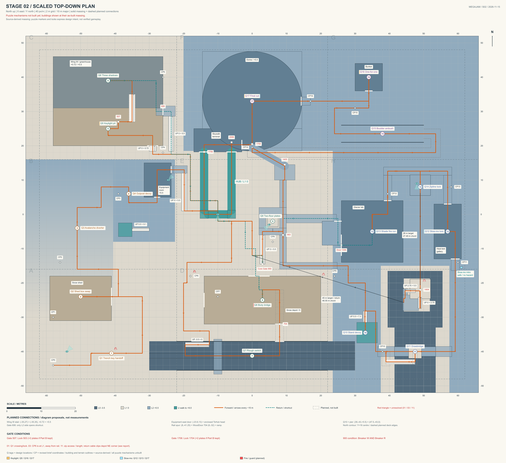
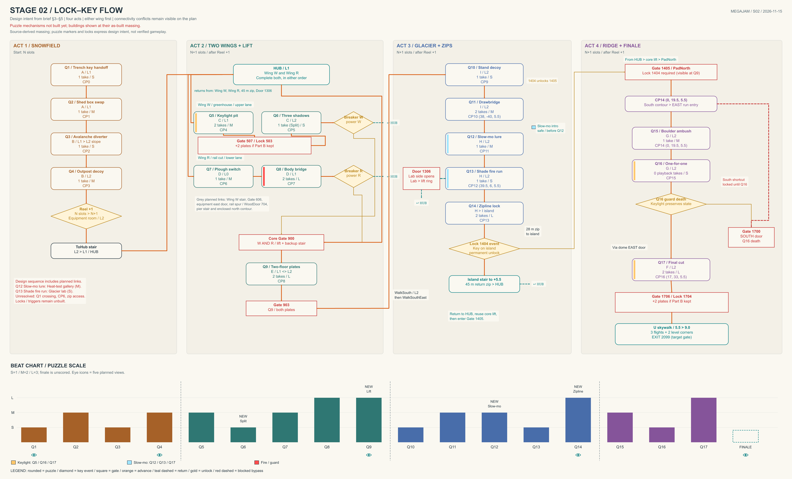
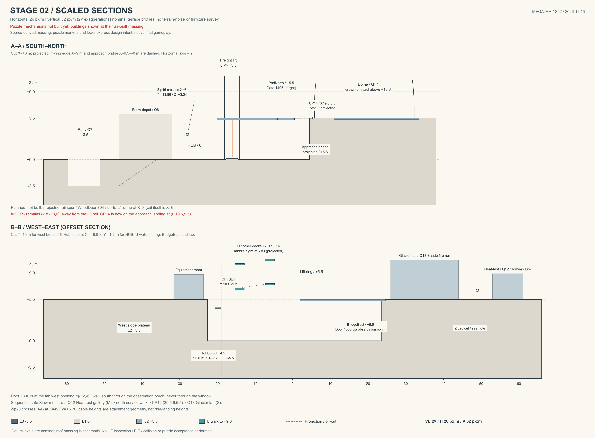

# Stage 2 · L_Stage02_SnowValley — Selected Design and Implementation Notes

> **Selected translated excerpts; full historical specification is not included.**
> Source: `Studio/Design/Maps/L_Stage02_SnowValley.md`, version v1, dated 2026-11-14 with updates through 2026-11-16.
> This is a historical design and implementation record, not a statement of the final release route. Later production decisions and release logs take precedence. In particular, the original 17-puzzle specification must not be read as 17 implemented puzzles.
> UE level asset: `/Game/MegaJam/Maps/L_Stage02_SnowValley`.

## Design Intent and Scale

Stage 1 was an indoor tutorial studio. Stage 2 moved into a daytime snow valley, with heated equipment rooms, greenhouses, and glacier laboratories between outdoor spaces. The design expanded the footprint while keeping the vertical structure manageable: three principal levels plus one rising finale walkway.

| Item | Historical specification |
|---|---|
| Footprint | `124 × 96 m`, `11,904 m²`; `X [-62,+62]`, `Y [-48,+48]` |
| Main elevations | `L0 -3.5 m`: railway/private recovery trenches; `L1 0 m`: camp/HUB/island; `L2 +5.5 m`: upper greenhouse/elevated routes/laboratory/ridge hall |
| Finale | Glass walkway rising from `+5.5 m` to `+9.0 m` |
| Planned content | 9 spatial groups, 17 logical `APuzzleRoom`s, 17 puzzles: 6 small, 7 medium, 4 large |
| Estimated first play | 28–36 minutes for the original design, not a measured final-build duration |
| Initial P0 implementation | 12 puzzles plus exit; individual PIE tests reported passing |

From 11/15, `A`–`I` mean only the nine spatial sectors. The central plaza is `HUB`, in sector E. The greenhouse is `Wing W`, powered by `Breaker W`; the railway is `Wing R`, powered by `Breaker R`. Their combined requirement is `W+R`.

The producer specified daylight on 11/15. The palette uses 70% cool-gray snow/rock, 25% charcoal steel/dark wood, and 5% saturated mechanism colors. Bright powder snow, directional sunlight, cool skylight shadows, and light distant fog distinguish the exterior; dry interior floors distinguish wood, painted steel, bare steel, and concrete. Warm-gold key lights (`#FFC86B`), ice-blue slow-motion cones (`#9FE6FF`), and red fire/guard cues (`#FF4D4D / #FF8A3D`) provide functional contrast.

## The Three Drawings

These drawings were generated in code from construction-script coordinates on 2026-11-15, rather than generated as AI illustrations. Each has a separate purpose:

1. **Top-down plan:** locations and routes, north up, to scale, with elevation colors, buildings, stairs, puzzles, checkpoints, shortcuts, gates, ziplines, and vistas.
2. **Flow and lock/key diagram:** sequence and dependencies; squares represent locks/doors, diamonds key-like requirements, and rounded boxes puzzles. A pacing strip appears below.
3. **Sections:** height relationships; north–south around `x≈+6`, and an east–west folded section, with 2× vertical exaggeration.







The puzzle circles mark planned positions. Gates and dashed "planned" lines express design intent, not proof of construction. Earlier 11/14 AI concept illustrations were not to scale and used old names; they were archived as atmosphere references.

Drawing generator: `Tools/draw_stage02_diagrams.py`. Its isolated environment is `Saved/s02-diagrams-venv/`:

```powershell
Saved/s02-diagrams-venv/Scripts/python.exe Tools/draw_stage02_diagrams.py
```

## Spatial Rules and Construction Corrections

The original route used two wings that could be completed in either order, returning to `HUB`. `W+R` opened the transport core. A second loop made a locked gate visible early and opened it after the east wing. The freight lift and ziplines remained scenery/traversal placeholders in P0, rather than the fully functional systems described in the original specification.

Because there was no fall damage, height alone could not prevent skips. Boundaries facing locked areas required floor-to-ceiling glass or solid barriers. Open edges could drop only into a puzzle's own recovery trench, separated from other trenches and the common valley floor. Backup stairs and connecting bridges needed the same progression gates as the intended route.

Construction review found concrete mismatches: the Q2 shelter was actually `18×13 m`, not the planned `32×28 m`; the dome's `29 m` diameter could not contain plates at `X=±18`; and the old zipline alignment passed through laboratory rooms. The finale's intersecting glass corridors were replaced with three ramps and two `2.4×2.4 m` corner platforms. Its original uniform `7.95%` slope was superseded by approximately `8.8% / 10.7% / 8.2%` segments. The displayed return cable measured approximately `46.6 m`, not exactly `45.00 m`; any functional timing would require recalibration.

## P0 Implementation and Later Recorded Changes

The producer approved starting with one global slot and upgrading to two in the equipment room; opening subtitles explained that cold had frozen one slot. Q5/Q17 Part B were removed, the freight lift became scenery, and P0 was prioritized.

**Latest explicit Q7 note in this source, 11/16 05:00:** the entire switch/snowplow puzzle was removed because the producer found too many bugs. The rail trench became a direct walking route and the branch doorway remained open. Earlier Q7 implementation and passing-test entries below that note are historical only. Notice `110` inside the spawn hut tells players the camp key is buried in snow.

| Puzzle | Implemented behavior and recorded differences |
|---|---|
| Q1 | Trench narrowed to **1.8 m**. Removed the takeoff-side low rail; return stairs climb only to the west bank. A double holds the key at the west edge; the player jumps east and takes it from the double, opening `Lock 102` and `Gate 103`. |
| Q2 | Box holds A to enter the first room and record standing on B. Rewind, play, then move the box from A to C; B+C opens the second door. An internal emergency switch permanently opens the return door. |
| Q4 | Rebuilt as a **straight corridor**: the guard's pursuit did not navigate the original T/L corners reliably. Record running into the western dead end, rewind, play, wait for the guard to pass the blind side passage, then emerge and operate the switch. |
| Upgrade | Entering the separate equipment room grants two slots and displays a subtitle. |
| Q5 | Replaced the excavated pit with a **3 m concrete enclosure**, since terrain could not be dug. Plate `501` controls bottom fire. Place the key on shelf `505`, illuminated through a pickup slot by light `506`; separate stairs and gates lead to `Breaker W` and shortcut door `606`. |
| Q7 | Removed on **11/16 05:00**; do not treat its earlier switch/fire/train solution as current. |
| Q8 | Producer changed it to **climb out using a crouched double** on 11/16. Removed fire, valve plate, key, lock, and west door. Far wall totals **1.9 m**; a stuck shutter prevents a running jump across. Record crouching below the far wall, rewind/play, step on the double, climb out, operate `Breaker R`, and return through north door `808`. Near wall is **1.05 m**, allowing unaided return. |
| Q9 | Retained original puzzle; caged backup stairs can only be entered through `Core Gate 900`. |
| Q11 | Replaced moving bridge with fixed bridge and gate `1104`; made the puzzle a **causal recording chain**. Plate `1101` opens signal-room door `1106`; record a second Take reaching `1102` while the first plays, then play both to open the bridge gate. |
| Q13 | **8 m** roofed fire corridor, **4 s** period and **2.2 s** off-window. Record a double blocking the slow-motion camera, then carry the key through at normal speed. `Lock 1302` opens laboratory west door `1308`, `BridgeEast` door `1306`, and `Gate 1405`, taking over progression after Q14 was cut. |
| Q16 | Full-room fire was infeasible because the tripwire could not ignite it; replaced with a **rolling snowball** through a **13 m** narrow corridor. Record entering and dying with the guard; rewind while the guard is lit through the west window. Guard stays dead and dome gate `1700` opens. |
| Q17 | Part A only: camera-blocking Take plus a second recording entering a **3 m** vault and shelving the key. Bottom fire cycles **8 s / 4 s**. `Lock 1704` opens return door `1708` and walkway door `1706`. |

The source reports passing individual tests for these implemented puzzles, including a negative Q13 test: crossing without a double blocking the camera is fatal. These reports precede or accompany subsequent removals; they do not establish final-release completion.

## Verification Boundaries

Individual puzzle tests teleported the player to each start; they did not initially traverse the connections. A later 11/16 route check used guide-line pathfinding: **50 cm grid**, crouched capsule, slope checks, **60 cm** steps, and **2.5 m** gap jumps. It found and fixed two blocking railings and an east-bank bypass that skipped Q13.

The closed-gate skip probe (`s02_probe_skip.py`, **18 groups**) then retained only two intended reachable cases: the bunker has no entrance gate, and the dome corridor uses periodic fire. Progression reachability (`reach_s02.py`) used a **40 cm** capsule flood-fill with slope checks. Each opened gate group exposed only the next area; no skip/out-of-map route was observed. It **did not simulate running gap jumps**; individual puzzle tests supplemented it.

Construction/test references: `Tools/build_stage02_mech.py`, `Tools/stage02_gameplay.py`, `Tools/stage02_mechlook.py`, `Tools/s02_test.py`, `Tools/ue_scripts/s02_tests.py`, and `Tools/reach_s02.py`. These are recorded validation methods, not a claim that this translation reran them. Later release-route cuts, including any early ending at HUB, must be checked against the later production logs rather than inferred from this historical map document.
